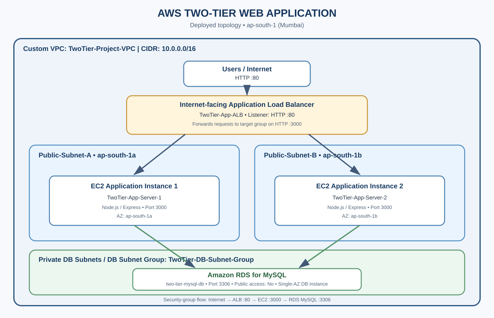
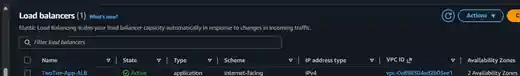
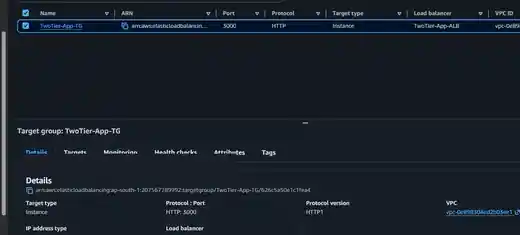
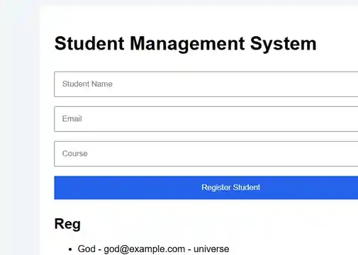
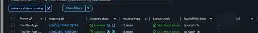

# Two-Tier Web Application Deployment on AWS

A hands-on deployment of a Node.js student management application on AWS using an Application Load Balancer, two EC2 application instances, and Amazon RDS for MySQL.

> **Deployment accuracy:** Both EC2 application instances run in public subnets. The RDS database is deployed privately. The two private application subnets created during setup are currently unused and are not represented as hosting application servers.

## Architecture



### Request flow
1. Users access the application through the internet-facing Application Load Balancer over HTTP port **80**.
2. The ALB forwards requests to the `TwoTier-App-TG` target group over HTTP port **3000**.
3. The target group distributes requests across two Node.js application servers on EC2 instances in separate Availability Zones.
4. The application servers connect to the private Amazon RDS for MySQL database over port **3306**.
5. The application reads and writes student records in the `studentdb` database.

### Deployed topology

| Component | Deployed configuration |
|---|---|
| AWS Region | Asia Pacific (Mumbai), `ap-south-1` |
| VPC | `TwoTier-Project-VPC`, CIDR `10.0.0.0/16` |
| Application Load Balancer | `TwoTier-App-ALB`, internet-facing, HTTP :80 |
| Target group | `TwoTier-App-TG`, HTTP :3000 |
| Application server 1 | `TwoTier-App-Server-1`, public subnet, AZ `ap-south-1a` |
| Application server 2 | `TwoTier-App-Server-2`, public subnet, AZ `ap-south-1b` |
| Compute | Two EC2 `t3.micro` instances running Amazon Linux 2023 |
| Application runtime | Node.js 22 / Express |
| Database | Amazon RDS for MySQL, private DB subnet group, public access disabled |
| Database instance | `two-tier-mysql-db`, Single-AZ deployment |
| Database used by app | `studentdb` |

### Subnet layout
- `Public-Subnet-A` — `10.0.1.0/24`; hosts application server 1 and is one of the ALB subnets.
- `Public-Subnet-B` — `10.0.2.0/24`; hosts application server 2 and is one of the ALB subnets.
- `Private-DB-Subnet-A` — `10.0.21.0/24`; part of the RDS DB subnet group.
- `Private-DB-Subnet-B` — `10.0.22.0/24`; part of the RDS DB subnet group.
- `Private-App-Subnet-A` (`10.0.11.0/24`) and `Private-App-Subnet-B` (`10.0.12.0/24`) were created during setup but are **currently unused**.

The RDS database is not publicly accessible. Its DB subnet group spans two private subnets, while the running DB instance itself is Single-AZ.

## Security configuration

| Security group | Inbound rule | Purpose |
|---|---|---|
| ALB security group | TCP 80 from `0.0.0.0/0` | Accept web traffic from users |
| EC2 security group | TCP 3000 from the ALB security group | Allow application traffic from the load balancer |
| EC2 security group | SSH TCP 22 from the configured administrator source / EC2 Instance Connect prefix list | Administration access |
| RDS security group | MySQL TCP 3306 from the EC2 security group | Permit database access from the application tier |

Application traffic is restricted to the ALB security group on port 3000. The RDS database accepts MySQL connections from the EC2 security group rather than from the public internet.

## Application functionality

The deployed web interface is a simple **Student Management System**.
- Register a student with a name, email address, and course.
- Submit student information through the Node.js application.
- Store student records in Amazon RDS for MySQL.
- Retrieve and display registered student records.

The Node.js application uses Express, `mysql2`, and `dotenv`. It listens on port 3000 and exposes a `/health` endpoint for target group health checks.

## Availability and process management
- The ALB spans two Availability Zones.
- Two EC2 application instances run in separate Availability Zones.
- The target group was verified with **2 healthy targets** in the captured deployment check.
- A `systemd` service named `two-tier-app.service` was configured on both EC2 instances to start and restart the Node.js application.

**Scope note:** The application tier is distributed across two AZs. The RDS database shown in this project is Single-AZ; this project does not claim Multi-AZ database failover.

## Screenshots

The following evidence is arranged in deployment flow order.

### 1. Application Load Balancer
The internet-facing ALB is active and configured across two Availability Zones.


### 2. Target group health
The `TwoTier-App-TG` target group forwards HTTP traffic to port 3000. The captured console view shows two healthy targets.


### 3. Amazon RDS MySQL
The RDS MySQL database instance is available and configured for private database access.


### 4. Running web application
The Student Management System page displays the registration form and registered student records.


### 5. EC2 application instances
Two EC2 instances are running in `ap-south-1a` and `ap-south-1b`. Public IP values are masked in this repository screenshot.


## Technologies and AWS services
- **AWS:** Amazon VPC, EC2, Application Load Balancer, EC2 Target Groups, Amazon RDS for MySQL, Security Groups, Internet Gateway
- **Application:** Node.js, Express.js, HTML, CSS, JavaScript
- **Database driver/configuration:** `mysql2`, `dotenv`
- **Operating system:** Amazon Linux 2023
- **Service management:** Linux `systemd`

## Repository contents

```text
aws-two-tier-web-application/
├── README.md
└── screenshots/
    ├── aws-two-tier-architecture.png
    ├── 01-application-load-balancer.webp
    ├── 02-target-group-health.webp
    ├── 03-rds-mysql-database.webp
    ├── 04-student-management-application.webp
    └── 05-ec2-instances.webp
```

This repository currently contains deployment documentation, an architecture diagram, and console/application evidence. The application source code can be added as a separate `application/` directory.

## Security reminder

Never commit `.env` files, database passwords, AWS access keys, private keys, or other credentials. Use environment variables or a secure secrets service for configuration. The screenshots in this repository are intended as deployment evidence and do not include database credentials.

## What I learned
- Designing a VPC with public and private subnet separation.
- Deploying and connecting EC2 application instances across Availability Zones.
- Configuring an internet-facing Application Load Balancer and target group health checks.
- Controlling application and database access using security-group references.
- Connecting a Node.js application to a private RDS MySQL database.
- Running a Node.js service persistently with `systemd`.